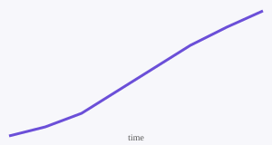

# Summary

In summary, this book has no content whatsoever. Structural health monitoring\index{structural health monitoring} (SHM) is a recurring theme[^shm], and so are sensors^[Accelerometers, strain gauges and fibre-optic sensors.].

[^shm]: SHM combines sensing, signal processing and statistical decision making.

::: {.column-margin}
**Margin note.** Margin content sits beside the text on wide screens, as in the HTML book.
:::

::: {.content-visible when-format="pdf"}
This paragraph only appears in the PDF version.
:::

```{=latex}
\begin{center}
\textit{Typeset only in the PDF.}
\end{center}
```



::: {#fig-growth-pair layout-ncol=2}

{#fig-growth-early}

{#fig-growth-late}

Two views of the same growth curve.

:::

See @fig-growth-pair and its panel @fig-growth-late.

::: {layout="[[1,1],[1]]"}


**A full-width row** under the two images: custom layouts can mix images and text.

:::

| Measure | Value |
|---------|------:|
| Natural frequency of the first bending mode | 3.2 Hz |
| Damping ratio | 1.4 % |

: Modal properties {#tbl-modal tbl-colwidths="[75,25]"}

<table>
  <caption>An HTML table</caption>
  <thead><tr><th>Sensor</th><th>Channel</th></tr></thead>
  <tbody><tr><td>Accelerometer</td><td onclick="alert(1)">A1</td></tr></tbody>
</table>

:::: {.columns}

::: {.column width="50%"}
**Left column**
Columns render **side by side** until you click into them.
:::

::: {.column width="50%"}
**Right column**
- Math: $a^2 + b^2 = c^2$
- A reference: @fig-growth
:::

::::

```{dot}
digraph G {
  rankdir=LR;
  node [shape=box, style=rounded];
  Write -> Preview -> Render;
}
```


